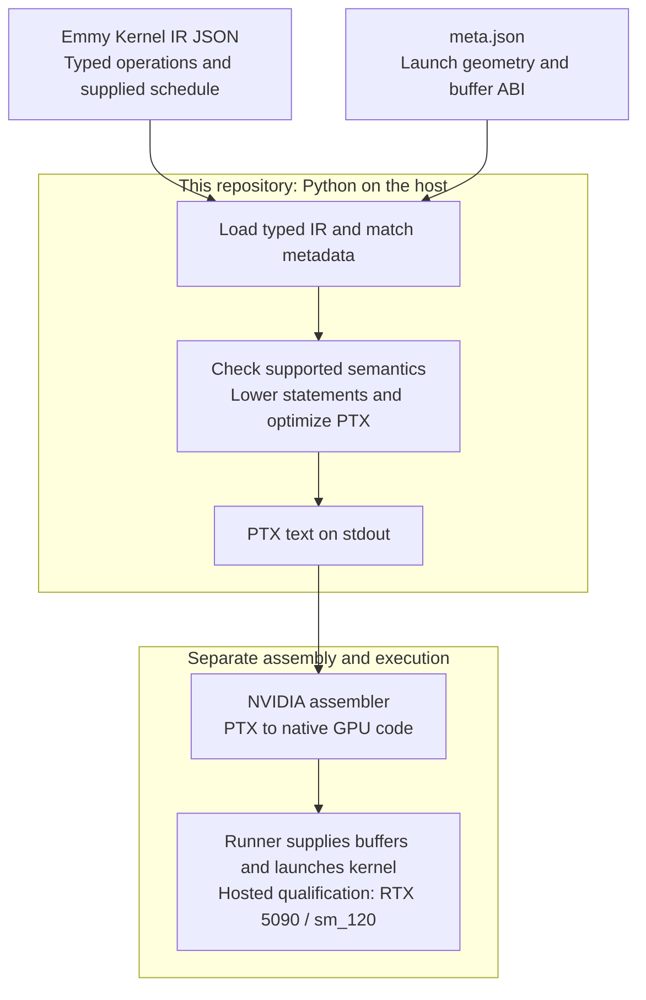
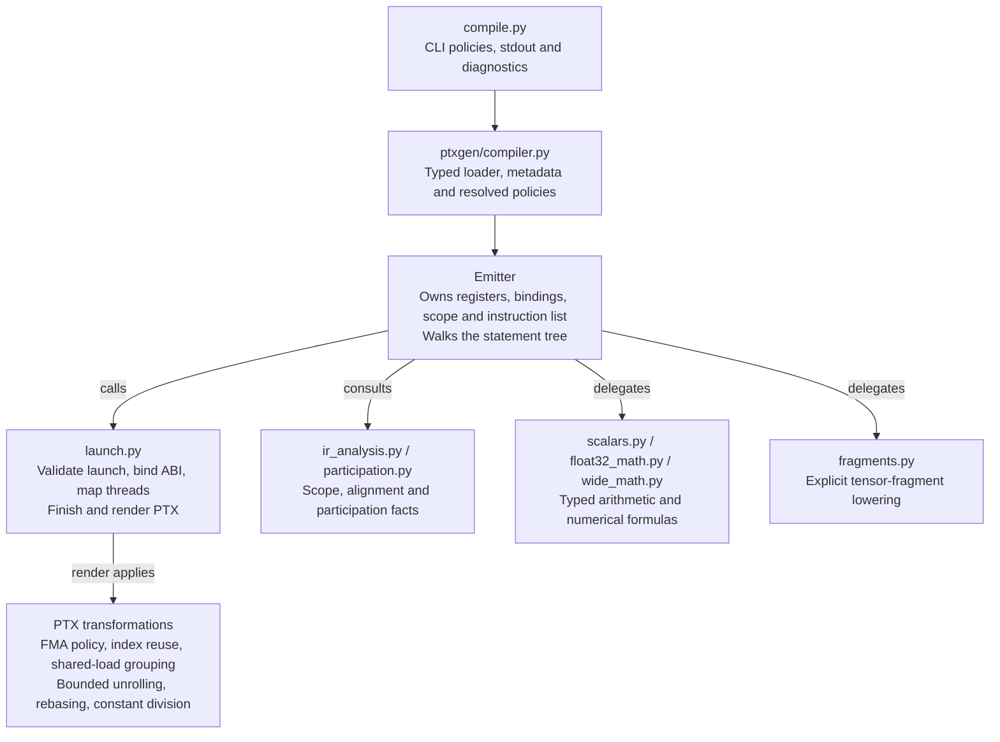

# Emmy Kernel IR to PTX

A direct Python backend for the Emmy Hackathon 2026. Emmy 0.3.11 loads the
serialized typed IR; this project emits its own PTX without invoking Emmy's
renderer, nvcc, libdevice, or another compiler. It preserves the supplied
schedule, launch geometry and positional buffer ABI.

Read [the design](DESIGN.md) for implementation details and
[the validation record](VALIDATION.md) for evidence and limitations.

This release includes generic address-arithmetic optimizations,
proven wider asynchronous copies, a bounded tensor-core lowering, and nine
portable examples. See [the feature guide](FEATURES.md) for the accepted IR.
The tensor path requires explicit fragment statements: none of the 15 public
problem IRs or 431 prior corpus inputs uses them. The existing FP32 matmuls
remain scalar FP32; upstream generation of this supported form is unestablished.

## From scheduled IR to GPU execution



The Python compiler builds a program; it does not execute the tensor operations.
It retains Emmy's supplied schedule rather than choosing a new tiling. Assembly
and GPU execution happen outside `compile.py`. Unsupported or unproved forms
raise a compile error instead of producing successful PTX output.

## Try it offline

After installing the pinned dependencies:

```sh
python tools/check_examples.py
python validation_records/performance-046/check.py
python validation_records/qualification-055/check.py
```

The first compiles nine examples and labels each reference/model check.
The next two replay complete saved experiments without sending requests.
See [the evidence guide](validation_records/README.md) for their different scope.
The compiler reads neither reference answers nor these recorded results.
Fable review 072 of `2c5d165` found no implementation blocker. Opus review 073
of `96c6d3a` closed its documentation correction with no remaining blocker or
required correction. Blake approved adoption on 2026-10-25. This release changes
only documentation from `96c6d3a`; executable files remain identical to `2c5d165`.

## Where to start reading

Follow `compile.py` → `ptxgen/compiler.py:compile_file` →
`ptxgen/emitter.py:Emitter.compile`. The last function shows the complete flow:
validate the launch, bind parameters, map threads, lower the body, assemble PTX.



Arrows show the main calls and responsibilities, not a complete import graph.
Helpers operate on the same emitter or return analysis facts; the boxes are not
separate processes or GPU stages. During `launch.render`, enabled passes run in
this order: guarded FMA contraction → integer reuse → shared-load grouping →
bounded unrolling → grouping again → shared-address rebasing → constant-division
lowering. Register declarations and the final PTX string are assembled afterward.

| File | Responsibility |
|---|---|
| `ptxgen/compiler.py` | Load typed IR, select metadata, resolve optimization policy |
| `ptxgen/emitter.py` | Registers, lexical scopes, statement dispatch, memory and collectives |
| `ptxgen/launch.py` | Kernel ABI, physical coordinates, final assembly and pass order |
| `ptxgen/ir_analysis.py` | Pure scope, alignment and uniformity facts |
| `ptxgen/scalars.py`, `float32_math.py`, `wide_math.py` | Typed instructions and numerical formulas |
| `ptxgen/index_reuse.py`, `optimizations.py` | Integer expression reuse and guarded FMA contraction |
| `ptxgen/loop_invariants.py` | Safe invariant integer arithmetic before loops |
| `ptxgen/fragments.py` | Checked one-warp FP16/FP32 tensor-core fragments |
| `ptxgen/constant_division.py`, `loop_unroll.py`, `shared_loads.py` | Exact constant division, bounded unrolling, proven load grouping and address rebasing |

The emitter is the single owner of mutable compilation state. The other modules
use ordinary function calls; there is no plugin registry, generated dispatch,
or inheritance framework to follow. See the design for a short walkthrough.

## Run

Use Python 3.12 or newer in an isolated environment:

```sh
python -m pip install -r requirements.txt
python compile.py path/to/kernel.ir.json > out.ptx
```

The IR directory must contain `meta.json`. The compiler selects its entry by
KernelOp name and follows `arg_order`. Missing, ambiguous or inconsistent
metadata produces an error on stderr and a nonzero exit. Successful stdout is
ASCII PTX 8.0 targeting `sm_89`; the hosted service compiled the qualified
artifacts for `sm_120`. Compilation requires no GPU, Torch or CUDA installation.

## Current evidence

The implementation reviewed in `2c5d165` enables the compact CLI defaults.
Its 28 backend modules match reviewed source `34129e9`; the CLI defaults,
helper policies and tests changed separately. This documentation-only successor
preserves every non-document file from `2c5d165`.

| Check | Result | Scope |
|---|---|---|
| Regression suite | 381 passing tests | macOS and fresh Linux ARM64/x86-64 installs |
| Default and rollback identity | 440 inputs each (431 corpus plus nine examples) | Offline PTX identity; rollback reproduces the preceding CLI backend |
| Linux portability | 381 tests, 440 default hashes and three portable commands on each | Recorded on `03707bd`; executable files unchanged here |
| Hosted batches 064/068/069/071 | 15 corpus kernels plus all nine examples pass | The current default reproduces all 24 hardware PTX payloads byte for byte |
| Performance comparisons 064/068 | Seven corpus cases, including flat controls | Same-batch comparisons on the shared service; see VALIDATION.md |

Fable independently reproduced 381 tests and the 440-output default/rollback
checks from the extracted `2c5d165` archive. All nine shipped examples ran in
batch 069. Most of the 429 changed corpus outputs have only offline assembly
and model evidence; 440 output checks do not mean 440 GPU tests.

The tensor checks cover small exact-integer FP16 inputs, not general FP16
accuracy or throughput. Single copy/sync runs do not prove race freedom.
Single-iteration qualification times are not benchmarks. The historical
all-zero sync witness cannot distinguish stores from no stores on zero-initialized
output; its stores were checked separately in a CPU model.
The bundled 046/055 replay packets describe earlier sources, not additional
hardware qualification of the current default. See [VALIDATION.md](VALIDATION.md)
for failed trials, numerical limits, current results and historical reviews.
No hidden-set or ranking claim is made.

## Optimizations and numerical policy

The CLI enables the qualified compact backend by default. It replaces
signed division/remainder by positive constants with exact integer arithmetic,
unrolls only eligible annotated bounded loops, and combines aligned shared loads
when address and dependency proofs permit. It keeps the supplied schedule and
each accumulator's floating-point order. The Python API remains opt-in.

The emitter itself is byte-identical to experimental source `34129e9`. Across
batches 064/068/069/071, 15 corpus fixtures and all nine shipped examples have
passing hardware results on the hosted sm_120 service. This is a sampled set,
not GPU coverage of all 429 changed corpus outputs. The backend's default output
is the same PTX tested with the three options explicitly enabled.

The matched main-matmul comparison measured 31.272 to 15.480 microseconds (2.020x)
against the previous backend; nvcc compiling the organizers' CUDA measured
15.032 microseconds in that same batch. These are means of two request medians
on a shared service, not cuBLAS results or statistical confidence. Rectangular
and asymmetric-attention cases also improved; small-K and split-K controls
were effectively flat. See VALIDATION.md for limits and the per-batch evidence.

An earlier optimization reuses repeated integer address arithmetic.
Registers have value identities; redefinitions invalidate them. A result is
reused only while a register still holds the same expression at the same width.
Labels, predicates, branches, collectives and unknown instructions clear facts.
Memory loads and floating-point arithmetic are not reused by this pass.

The CLI defaults to `EMMY_PTX_INDEX_REUSE=auto`. It selects loop-scoped reuse
only when the resolved FMA policy is enabled and short-tree lowering is off.
The structural selector requires an actual division/remainder replacement in a
backward branch's instruction span, then applies the full reuse pass to that
kernel. It is a scope restriction, not a profitability predictor. It uses no
problem names, timing tables or shape-specific exceptions.

A historical bounded family comparison measured 2.378× for the original staged matmul and
about 2.28× for three related launch sizes. The split-K control measured 1.008×,
effectively flat, and remains selected. These compare against our own preceding
backend, not nvcc. The broader initial screen failed its adoption criterion;
that result is retained in the validation record.

The CLI also defaults to `EMMY_PTX_CONTRACT_FMA=auto`. Only adjacent register-only
`mul.rn.f32`/`add.rn.f32` pairs with a single-use product and an addition emitted
from typed `Accum` are eligible. Metadata must explicitly give finite nonnegative
tolerances with positive `atol`. Ordinary pointwise additions remain separately
rounded. Missing, invalid, exact or relative-only tolerances retain strict
arithmetic. FMA rounds once rather than twice: this guard is not an error bound
for arbitrary cancellation, overflow or reduction inputs. Explicit FMA used
inside approximation formulas is part of those formulas, independent of this
optional contraction pass. These policies must be disclosed in the submission.

| Setting | Default | Alternatives |
|---|---|---|
| `EMMY_PTX_CONTRACT_FMA` | `auto`, guarded Accum contraction | `0`: no contraction; `1`: broader adjacent contraction, requires eligible tolerances |
| `EMMY_PTX_INDEX_REUSE` | `auto`, guarded loop selection | `0`: off; `loop`: explicit loop selection; `1`: unrestricted reuse |
| `EMMY_PTX_CONSTANT_DIVISION` | `1` | `0`: retain division/remainder instructions |
| `EMMY_PTX_UNROLL` | `1` | `0`: retain annotated loops |
| `EMMY_PTX_SHARED_LOADS` | `compact` | `off`, `address`, `vector`: disable or limit shared-load transformations |
| `EMMY_PTX_SHORT_TREE` | `0` | `1`: experimental eligible shared trees lowered through warp shuffles |

Set all three new settings to `0`, `0`, and `off` to reproduce the preceding
CLI backend; FMA and reuse keep their existing independent settings.

Python `compile_file` defaults keep contraction, index reuse, constant-division
lowering, unrolling, shared-load changes and short-tree lowering off; callers can request the documented policies explicitly.
Explicit strict+loop, tree+loop and unrestricted reuse are not qualified across
all changed fixtures. Short-tree lowering passed a limited correctness screen
but failed its performance gates and stays disabled by default.

## Supported scope and refusal boundaries

- Scalar storage and arithmetic preserve f16, f32, f64, i32 and i64 widths;
  equal-width bitcasts preserve bits. Typed folds, shared trees and shuffles
  retain state widths. Unsupported or inconsistent types refuse.
- Floating floor division and remainder preserve the documented divisor-sign
  convention, including signed zero. Integer arithmetic is finite-width;
  negative integer power exponents and invalid division domains are not
  interpreted as arbitrary-precision Python arithmetic.
- The f32 `exp`/`exp_fast`, `exp2`, `log`, `log2`, `log10` and `rsqrt` paths
  use GPU approximate instructions: `ex2.approx.f32`, `lg2.approx.f32` and
  `rsqrt.approx.f32`. The f32 sigmoid, SiLU, tanh, softplus, erf and GELU
  implementations are built on `ex2.approx.f32`, including `gelu_tanh`.
  Accuracy evidence comes from fixture tolerances and bit-readback probes,
  not a guarantee of correct rounding. The f64 paths are separate explicit
  lowerings.
- Runtime powers, full-range sine/cosine, and direct f64 math use explicit PTX
  lowerings. Their accuracy evidence is sampled; they are not universally
  correctly rounded libm replacements. The generated typed IR's explicit
  rounding can differ from a higher-precision reference.
- Ordinary lexical shadows restore outer bindings. Definitely initialized
  nested fold results can escape conditionals; partially initialized values
  never receive an invented neutral result. Collective partner and temporary
  collisions refuse. Orphan Accum acceptance remains a malformed-input limit.
- Global Tile decoding uses wide coordinates when necessary, narrowing each
  axis only after checking its range. The schedule is a single top-level Tile
  with a one-dimensional launch, including supported auxiliary thread bands.
- Collective predicates and loop counts must agree within the actual CTA,
  warp or proven counted-barrier cohort. Immutable coordinates and proven
  same-address read-only global loads can establish agreement. Mutable,
  varying or otherwise unproved inputs cannot. Unknown correlated branches
  and arbitrary memory-derived tree coordinates can refuse conservatively.
- Shared trees prove a participating writer for each node/slot; partial groups
  must satisfy the supported cohort rules. Partial final warps for shuffle
  operations require complete aligned shuffle-width groups. Physical lane
  membership is distinct from logical Tile coordinates.
- Shared memory supports the typed software XOR and V70 layouts, scalarized
  unaligned vectors, and async copies whose payload remains contiguous after
  mapping. Shared-memory ordering and launch-time zeroing remain explicit IR
  and metadata responsibilities.

Additional boundaries: floating `BinaryExpr` arithmetic supports `+`, `-` and
`*`; `/`, `//` and `%` in that expression form refuse (the separate typed
operations have their own lowerings). Serial launch coordinates and scalar-by-value
arguments refuse. Blocks whose size is not a multiple of 32 support only shuffle
collectives. Metadata cannot detect a same-shaped input swap when an entry is
reused at another launch site. Min/max reduction identities use the typed
operator's finite sentinels, so inputs must respect those identities.

The compiler is not a complete malformed-IR validator. Unsupported semantics
fail explicitly; passing the public problems does not prove hidden-set coverage.
See the design for exact proof rules and the validation record for the distinction
between local models, assembler checks, artifact identity and hardware tests.

## Local validation

The official task checkout is separate, initially pinned at
`ec8cde1943f88efea3827a95bda6085553d2d407` from the
[organizer repository](https://github.com/cloudrift-ai/emmy-hackathon-2026).

```sh
python -m pip install -r requirements-dev.txt
EMMY_TASK_ROOT=/path/to/emmy-hackathon-2026 python -m unittest discover -s tests -v
```

The local suite uses mocked runner contracts and does not make hosted requests.
The compiler dependency is `emmy-ml==0.3.11`; development requirements also pin
`requests` for the test helpers. `tools/make_*variants.py` creates independent
fixtures outside the source repository. The hosted helper `tools/run_cases.py`
is separate from local testing and makes real service calls; the recorded work
used bounded, reviewed batches with no automatic retries.

`tools/compare_versions.py` is an optional development comparison, restricted to
single-kernel fixtures with f32 buffers and finite f32 references. It refuses
other dtypes instead of rounding their results to f32. It prepares both compilers
locally by default and sends **zero requests**. Explicit `--execute` sends at most
8 requests per case (2 compilations and 6 runs, each with 5 warmups and 50 timed
iterations). Busy responses, transport errors and incorrect outputs stop the
batch without retries; redirects are disabled. This helper is separate from the
reviewed typed qualification batches, and is not a reason to repeat those runs.
